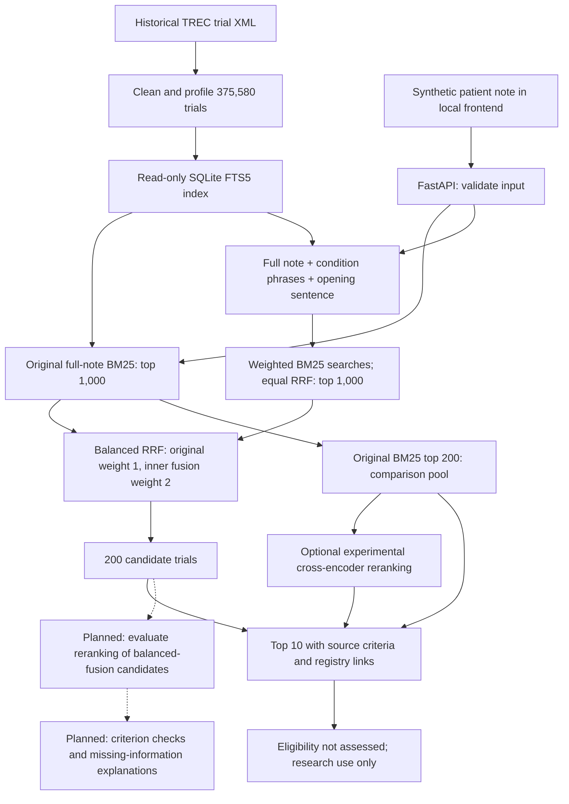

# Clinical Trial Matcher: patient note → ranked trials

**Status:** The local BM25 research baseline, exploratory reranking evaluation, and FastAPI/frontend demo are implemented. The two-image Docker build, startup, search, restart and index reuse were verified locally on Linux/x86-64 Docker Desktop. An Azure PoC plan is prepared; Azure deployment remains unverified. The full staged matcher below is the target architecture.

## Run the first local Docker version

With Docker Desktop running, execute these commands from the repository root. Both images must already be built or loaded:

```powershell
docker compose -f .\demo\compose.images.yaml up -d --no-build --pull never
Invoke-RestMethod http://localhost:8000/health/ready
```

Open **[http://localhost:8000](http://localhost:8000)**. The index initializer exits successfully after verifying or initializing the persistent volume; the app stays running. A full startup hashes the 2.22 GB index and can take over a minute on this machine. This is verification, not an image rebuild.

Stop the app and preserve its index:

```powershell
docker compose -f .\demo\compose.images.yaml down
```

For an app-only update on an already initialized installation:

```powershell
docker compose -f .\demo\compose.images.yaml build matcher
docker compose -f .\demo\compose.images.yaml up -d --no-build --pull never --no-deps --force-recreate matcher
```

This reuses the existing index image and volume. Avoid `down -v` if retaining the data. The images are local build artifacts, not stored in Git; see [image export/load instructions](demo/INDEX-IMAGE.md) for another computer.

**Ranking in this version:** the frontend has one search action and uses server-selected balanced fusion, retaining 200 candidates and displaying ten. It is selected for candidate coverage, eligible recall@10 and CPU latency, not superiority on every metric. Explicit research API requests still support BM25 and the original BM25-pool cross-encoder; the frontend has no method selector. The combined [2021 experiment is incomplete and deferred](reports/reranking/balanced_reranker/README.md), with no new quality claim. All displayed results have eligibility unchecked.

A staged pipeline that takes a free-text patient description, cleans it, extracts structured eligibility facts, narrows a large registry of clinical trials down to a short list, checks eligibility criterion by criterion, and returns an explainable top-10 ranking. A clinician or trial coordinator makes the final decision.

Scored with **nDCG@10** against graded relevance judgments (0 = not relevant, 1 = excluded, 2 = eligible).

> Research and portfolio project. Not a medical device and not for real patient decisions.

---

## 1. Problem

Given:
- a **patient description** (a synthetic admission-note-style free text)
- a **pool of clinical trials** (long registry records: title, summary, conditions, interventions, and inclusion/exclusion criteria written as prose)

Produce, per patient, an ordered list of trial IDs, best first. The primary metric scores the top 10; recall also measures candidate coverage at 30 and 200.

Why it is hard:
- Trial documents are long, and eligibility rules are buried in free text.
- Medical abbreviations, negation ("no history of…"), and numeric thresholds ("eGFR > 30").
- Patient notes omit most of what a trial asks about, so missing ≠ ineligible.
- "Relevant but excluded" must rank below "eligible".

## 2. Design principle

**Understand the data first, spend LLM calls last.**
Cheap stages shrink the pool; the expensive LLM stage only sees the survivors. Every LLM and embedding call is cached by content hash.

## 3. Pipeline

The frontend exposes one server-configured pipeline (currently balanced fusion); other paths in the diagram are explicit research API options. See the [next development experiments](reports/next-retrieval-experiments.md).

The working implementation is a fixed pipeline; autonomous agents are not
required. Solid arrows below show available paths. Dashed arrows show planned
work. The detailed stage table afterward describes the longer-term architecture.



The current cross-encoder experiment uses its frozen original BM25 candidate
pool, with a fixed scoring batch protocol described in [demo/README.md](demo/README.md).
Balanced-fusion reranking was started but stopped before selection and validation; it remains an incomplete experiment, not an evaluated combined system. Reranking the same 200 candidates changes top-ten quality but
cannot change eligible recall@200.

| # | Stage | Method | Output |
|---|-------|--------|--------|
| 0 | **Profile the data** | length distributions, null/empty fields, abbreviation frequency, criteria-section detection rate | `reports/data_profile.md` |
| 1 | **Clean and normalize** | whitespace/HTML cleanup, split each trial into sections (summary, conditions, inclusion, exclusion), normalize units | `data/clean/trials.parquet` |
| 2 | **Parse the patient** | LLM → structured JSON (schema below), cached | `data/cache/patients/` |
| 3 | **Parse trial criteria** | split inclusion/exclusion into atomic criteria, tag each (condition, age, lab, medication, procedure, other), cached | `data/cache/criteria/` |
| 4 | **Retrieve** | hybrid: BM25 over trial text + biomedical/multilingual-agnostic embedding of patient vs. trial; fuse with reciprocal rank fusion; keep top-200 | candidate trials |
| 5 | **Hard filter** | rule-based on age, sex, condition mismatch; **unknown ≠ fail** | filtered pool |
| 6 | **Criterion-level matching** | LLM judges each (patient, criterion) as `met / not_met / unknown` with a one-line reason, only on top-30 | per-criterion verdicts |
| 7 | **Aggregate and rank** | score = weighted met inclusion minus violated exclusion, `unknown` penalized lightly; ties broken by retrieval score | top-10 |
| 8 | **Explain** | per-trial summary: which criteria matched, which are unknown, which exclude | shortlist JSON |
| 9 | **Evaluate** | nDCG@10, recall@10, and an eligible-vs-excluded confusion check | `reports/eval.md` |

### Patient schema (stage 2)

```json
{
  "patient_id": "P-001",
  "age": 54,
  "sex": "female",
  "conditions": ["type 2 diabetes", "hypertension"],
  "medications": ["metformin", "lisinopril"],
  "labs": [{"name": "HbA1c", "value": 8.1, "unit": "%"}],
  "history": ["no prior stroke"],
  "negations": ["no known drug allergies"],
  "unknowns": ["smoking status", "renal function"]
}
```

Store negations and unknowns explicitly. They drive stages 5 and 6.

## 4. Orchestration

Wire stages 2–8 as a **LangGraph** workflow (one node per stage; state = patient, candidate trials, verdicts, scores) so a run can resume from any node. Build and validate each stage as a plain function first; add the graph last.

## 5. Evaluation

- **Metric:** nDCG@10 (primary), recall@10, plus a check that "excluded" trials do not outrank "eligible" ones.
- **Labels:** graded judgments 0 / 1 / 2 from the TREC Clinical Trials tracks. Some evaluations keep only the 1 and 2 pairs (eligible vs. excluded); decide your convention up front and keep it fixed.
- **Splits:** tune on one year, report on another (for example tune on 2021, report on 2022). Never tune on the set you report.
- **Ablation ladder, in order:** (1) BM25 only, (2) embeddings only, (3) hybrid, (4) hybrid + hard filter, (5) + criterion-level LLM matching, (6) + aggregation tuning. Log every run so the results table writes itself.

## 6. Data

| Source | What it gives you |
|--------|-------------------|
| **TREC Clinical Trials 2021** | 75 patient topics, about 350K trial descriptions, graded judgments |
| **TREC Clinical Trials 2022** | same collection, 50 new topics; 2021 judgments usable for tuning |
| **TREC Clinical Trials 2023** | 40 topics, 450K+ trials (2023 ClinicalTrials.gov snapshot) |
| **SIGIR 2016 patient-trial cohort** | smaller test collection, useful for fast iteration |
| **TrialGPT repo** (`github.com/ncbi-nlp/TrialGPT`) | parsed trial data download, links to the TREC corpora, reference code for retrieval / matching / ranking |

Notes:
- Patient topics are **synthetic** cases written by people with medical training, so there is no real patient data.
- Check the access steps and terms for each TREC collection yourself before relying on them; I have not verified them.
- English only.
- Develop on a slice (for example 10 patients and the trials judged for them) before touching the full corpus.

## 7. Suggested repo layout

```
clinical-trial-matcher/
├── README.md
├── data/
│   ├── raw/            # untouched downloads (gitignored)
│   ├── clean/          # parquet after stages 0–1
│   └── cache/          # LLM + embedding caches keyed by content hash
├── notebooks/
│   └── 00_profile_data.ipynb
├── src/
│   ├── clean.py
│   ├── parse_patient.py
│   ├── parse_criteria.py
│   ├── retrieve.py         # BM25 + embeddings + RRF
│   ├── filters.py
│   ├── match_criteria.py   # LLM met / not_met / unknown
│   ├── aggregate.py
│   ├── explain.py
│   ├── evaluate.py         # nDCG@10, recall@10
│   └── graph.py            # LangGraph wiring
├── api/                    # FastAPI: POST /match
├── reports/
└── docker-compose.yml
```

## 8. Cost and safety rules

- Cache every LLM and embedding call by hash of (model, prompt, input).
- Print a call and token estimate before any batch run; require a flag to exceed a set budget.
- The criterion-level LLM stage runs only on the top-30 per patient, never on the full pool.
- Every ranked trial carries its per-criterion reasons so a human can verify it.
- Treat all outputs as decision support; a human decides.

## 9. Local baseline quickstart

The implemented milestone is data ingestion, profiling, **BM25 retrieval**, and
benchmark evaluation. A separate experimental FastAPI/frontend demo and Docker setup are described below in the demo section. Dense retrieval remains experimental; criterion-level eligibility matching is a later milestone. BM25 results indicate lexical relevance, not eligibility.

Install [uv](https://docs.astral.sh/uv/getting-started/installation/) and run from
the project root in PowerShell. The setup uses project-local Python and caches:

```powershell
$env:UV_PYTHON_INSTALL_DIR = Join-Path (Get-Location) '.python'
$env:UV_CACHE_DIR = Join-Path (Get-Location) '.uv-cache'
uv sync --frozen
.\.venv\Scripts\python.exe -m src.diagnostics
.\.venv\Scripts\python.exe -m pytest -q
.\.venv\Scripts\python.exe -u -m src.download
.\.venv\Scripts\python.exe -u -m src.clean
.\.venv\Scripts\python.exe -u -m src.retrieve build
.\.venv\Scripts\python.exe -u -m src.evaluate
```

Alternatively, `./scripts/run_baseline.ps1` runs the sequence and stops on failure.
Do not launch concurrent builds into the same output paths. A full rebuild can
take time; once the clean data and index exist, search/evaluation reuse them.

If the archive host returns HTTP 406, manually download the five ZIPs linked on
[the official track page](https://www.trec-cds.org/2021.html) into
`data/raw/trec2021/`. Keep their original filenames and leave them zipped. Run
`src.download` again: it registers the local archives after checking the reference
MD5 checksums, records SHA-256 fingerprints, and fetches the small topics/qrels.
No extraction is needed. CRC verification happens while reading each XML member.
If cleaning is interrupted, keep the completed temporary Parquet batches, rename
`trials.parquet.partial` to `trials.checkpoint.parquet`, then resume with:

```powershell
.\.venv\Scripts\python.exe -u -m src.clean --resume-from data/clean/trials.checkpoint.parquet
```

The interrupted process must have exited first. Recovery validates the cached
raw XML against each official archive CRC before reusing rows. Keep the same
parser configuration and archives when resuming; restart cleaning after any
normalization change. An incomplete file without a Parquet footer cannot resume.
Downloaded datasets, runtime files, caches, and indexes are excluded from Git.
Data-use terms and citations are recorded in `data/manifests/trec2021.json`.

Search with an example note (retrieval only):

```powershell
.\.venv\Scripts\python.exe -m src.retrieve search --note "54-year-old woman with type 2 diabetes taking metformin" --top-k 10
```

Use `--note-file path/to/note.txt` for a longer note and `--output results.json`
to save the response. Research benchmark notes only; no clinical decisions.

Outputs:

- `data/clean/trials.parquet`: normalized fields plus original XML and provenance.
- `reports/data_profile.md` and `.json`: field quality, lengths, section detection,
  abbreviation candidates, counts, and parsing checks.
- `reports/topic_review.txt`: engineering review of development topics 1-10.
- `data/indexes/bm25.sqlite`: local, disk-backed SQLite FTS5 BM25 index.
- `reports/bm25_v1/`: evaluation report, standard TREC run, full candidate rankings,
  per-topic metrics, timing, fingerprints, and examples of missed eligible trials.
- `notebooks/00_profile_data.ipynb`: optional inspection of generated statistics.

The fixed baseline searches title, conditions, summary plus detailed description,
and eligibility, with equal field weights. It uses SQLite's Porter/unicode61
index tokenizer and OR-combines unique note tokens after a fixed English stopword
list. Higher JSON scores are better (SQLite's native negative BM25 sign is reversed).
Score ties are ordered by trial ID. The TREC export uses descending rank integers
to preserve this exact order in evaluators with different score-tie conventions;
native BM25 scores remain in `rankings.json`. Native FTS5 top-k retrieval expands
boundary ties before sorting by ID; regression tests compare its exact ordering
and scores with exhaustive BM25 sorting. No clinical facts are inferred.
See [SQLite FTS5 scoring](https://www.sqlite.org/fts5.html#the_bm25_function).

Evaluation uses topics 1-10 of TREC 2021 against the **full snapshot**. Primary:
nDCG@10 with linear gains 0/1/2, matching trec_eval. Secondary: eligible-only
recall at 10/30/200 (grade 2 positives). Unjudged results have gain zero but remain
explicitly marked unjudged in diagnostics. Recall is N/A for a topic with no
eligible judgments. Every topic's nDCG and recall are independently checked with
`pytrec_eval`. These are development results; TREC 2022 scoring is deferred; see [status and limited prior exposure](reports/trec2022-status.md).

## 10. Roadmap

- [x] Stage 0 data profile report
- [x] Trial section splitting (summary / inclusion / exclusion; original text retained)
- [ ] Patient parser with explicit negations and unknowns
- [ ] Criteria parser
- [x] Full-corpus BM25 retrieval baseline
- [ ] Embeddings + RRF hybrid retrieval
- [x] Evaluation harness and first BM25 results table
- [ ] Remaining retrieval/filter/LLM ablations
- [ ] Hard filter with "unknown ≠ fail"
- [ ] Criterion-level matching + aggregation
- [ ] Explanations
- [ ] LangGraph workflow
- [x] Experimental FastAPI endpoint and research frontend
- [x] Lexical fusion and cross-encoder experiments
- [x] Docker/Compose files prepared
- [x] Docker build/run verification (Linux/x86-64 Docker Desktop)
- [ ] Azure PoC deployment

## 11. Frontend, containers, and deployment

The [`demo/`](demo/README.md) package implements a research frontend and FastAPI `POST /match` endpoint for ranked trials, source eligibility text, and registry links. Criterion-level matched/excluded/unknown explanations remain a later stage.

Docker/Compose runs the app with a separate, versioned trial-index image and a persistent read-only index mount. Local image build, first initialization, search, restart and index reuse passed; see [verification](demo/VERIFICATION.md). An [Azure PoC plan](demo/AZURE.md) describes HTTPS, authentication, secrets, resource limits, persistent storage, and eventual cleanup. Azure deployment has not been executed. The same image and index can run locally after Azure access ends.

TREC 2022 evaluation is deferred until development is complete; see [exposure/status record](reports/trec2022-status.md). A synthetic-note engineering PoC can proceed independently of the final retrieval benchmark. Continue model development on TREC 2021; repeated 2022 checks become regression measurements. Use synthetic/de-identified research notes.

## 12. First measured development result

Full corpus: **375,580 trials**. Fixed first **10 TREC 2021 topics**.

| Method | nDCG@10 | Eligible recall@10 | Eligible recall@30 | Eligible recall@200 |
|---|---:|---:|---:|---:|
| BM25 v1 | 0.4112 | 0.0193 | 0.0492 | 0.1835 |

This is an untuned development baseline, not held-out performance or a clinical
validation. See `reports/bm25_v1/eval.md`, `error_analysis.txt` and
`reports/validation.json`. All 14 tests pass. TREC 2022 scoring is deferred; see [status and limited prior exposure](reports/trec2022-status.md).

## Experimental reranking and portable demo

A separate [`demo/`](demo/README.md) package provides a FastAPI `POST /match` endpoint and a responsive frontend for patient notes, top-ten candidates, source eligibility criteria, and registry links. It supports original BM25, lexical fusion, and experimental cross-encoder reranking. The frontend automatically uses balanced fusion; explicit research API requests retain the other methods. Relevance scores do not establish eligibility.

See [`reports/reranking/results.md`](reports/reranking/results.md) for the fixed comparison on 45 development and 30 reused internal-validation TREC 2021 topics. These exploratory results are not an untouched test. TREC 2022 scoring is deferred; see [status and limited prior exposure](reports/trec2022-status.md).

Docker Compose and an [Azure PoC plan](demo/AZURE.md) keep the index separate from the app image, so local Docker use can continue when Azure access ends. The Python API, browser workflow and two-image Docker build/run were checked locally; Azure deployment remains unverified. No Azure resources were created.

## Local use and portfolio hosting

**Primary delivery: local Docker, with screenshots and a recorded browser demo.**
There is no requirement to maintain a running Azure deployment. Reviewers who
want to run the app need Docker, the application image, and the trial index/model
assets described in the setup instructions. Screenshots and demo recordings can
be captured from localhost without cloud hosting.

Run the frontend and API locally with Python, or use the verified [two-image Docker Compose setup](demo/INDEX-IMAGE.md). Local inference needs no Azure
subscription or paid model API. See [local commands and low-cost PoC options](demo/POC-OPTIONS.md).

Balanced fusion is the candidate-retrieval baseline for subsequent versions;
BM25 remains the comparison control. The frontend uses the configured pipeline without a method dropdown. Candidate
retrieval and reranking are fixed pipeline stages; autonomous agents are not
required. Eligibility remains unassessed.

For an optional live URL, use Azure Container Apps Consumption with HTTP scaling,
minimum zero and maximum one replica. Expect cold starts and check costs for
storage, registry and logs. Keep a stable portfolio/README link with screenshots,
a recorded walkthrough and local run instructions: an Azure URL stops serving
the app when its hosting resources are stopped or deleted. The same container
can later move to another host.

## Next development goal and research context

Preserve balanced fusion's **39.82% eligible recall@200 (roughly 40%)** while
improving top-ten ranking beyond the original BM25 control's **0.4701 nDCG@10**.
Balanced fusion currently scores **0.4484 nDCG@10** and **6.97% eligible recall@10**.
These values come from the same **30 reused internal-validation TREC 2021
patients**, searching all **375,580 trials**; they are development measurements.
The stated goal is a project milestone, not a clinical acceptance threshold or
an already achieved result. Report small recall changes explicitly rather than
rounding a regression into a claimed improvement.

Keep the candidate IDs fixed when testing rerankers, compare the same patients,
report eligible recall@10 alongside nDCG@10, and examine paired patient-level
differences and uncertainty. Selection uses the 2021 development protocol; this
reused validation set is not a new independent test. nDCG gives partial credit
to grade1 excluded trials, so higher nDCG alone does not establish more eligible
trials in the displayed ten. Freeze settings before a later holdout evaluation;
2022 remains deferred with its limited exposure [documented](reports/trec2022-status.md).

Related research provides context, not a directly transferable pass mark:

| Source | Reported result | Comparison limit |
|---|---|---|
| [IELAB authors' TREC implementation](https://github.com/ielab/trec-ct-2023#trec-clinical-trials-2021-results) | TREC 2021 BM25 nDCG@10 **0.3395**; BM25+ANCE hybrid **0.3488** | Different implementation and topic/evaluation setup; our reused 30-patient subset does not establish superiority over these runs. |
| [TrialGPT, Table 2 and evaluation methods](https://pmc.ncbi.nlm.nih.gov/articles/PMC10418514/) | BioLinkBERT cross-encoder **0.4797** and GPT-4 TrialGPT feature-combination **0.7275** nDCG@10 | Averages across three cohorts; TREC candidate corpora restricted to the union of judged trials (26,149 for 2021), then ranking top500 candidates. Our corpus has 375,580 trials. |

TrialGPT also reports over90% relevant-trial recall using under6% of its initial
collection. That is not eligible-only recall@200 on our full corpus: candidate
depth, label conventions and corpus differ. Do not compare those percentages as
equivalent. There is no single published minimum score that makes this PoC ready
for clinical use. For this portfolio, the next convincing result is a reproducible
improvement over our own fixed controls, together with a working local app.

The local app and two-image Docker workflow were exercised on 2026-11-17. Development continues on TREC 2021; no new 2022 evaluation or Azure deployment was run.
