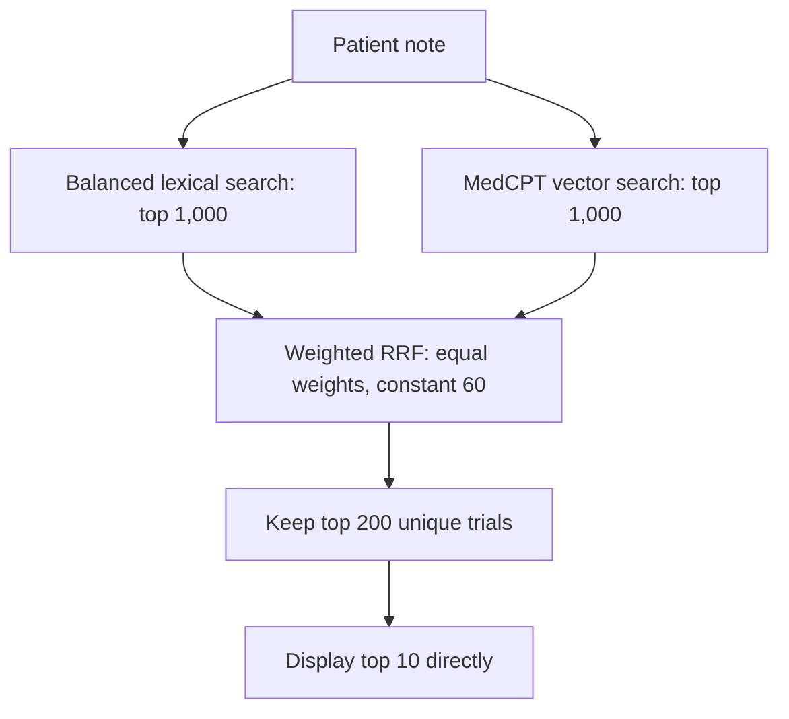

# Selected hybrid pipeline (19 November 2026)



No cross-encoder runs in this pipeline. Query inference uses the locally cached
quantized MedCPT query encoder with one ONNX thread. Trial vectors are reused;
serving never encodes trials or downloads a model. One search executes at a time.

The working bundle contains **5,120 historical trials**, not the current 65,080
recruiting records. It uses exactly the vectors evaluated in the pilot; it favours
earlier trial IDs and is not representative. The frontend reports the loaded
collection and this limitation. Eligibility remains unchecked.

## Run locally

From the repository root in PowerShell, with Python 3.12:

```powershell
py -3.12 -m venv .venv-hybrid
& .\.venv-hybrid\Scripts\python.exe -m pip install -r .\demo\requirements-hybrid.txt
& .\.venv-hybrid\Scripts\python.exe .\demo\build_hybrid_bundle.py --spec .\demo\bundles\pilot.json
& .\.venv-hybrid\Scripts\python.exe .\demo\serve_hybrid.py
```

Open <http://127.0.0.1:8000>. The bundle is already built on the development
machine; skip the build command to use it. The build command creates a new
versioned bundle and refuses to overwrite an existing output directory.
Packaging requires the original cached vectors, pilot report, SQLite subset and
pinned query model. These large local assets are not committed to Git.

`serve_hybrid.py` uses one logical CPU, low priority and one numeric thread. No
reranking and no automatic pausing. Override `PORT` if 8000 is occupied. Submitted
notes are not saved or written to the access log.

## Configure another collection

The builder accepts `--spec <JSON file>` and an optional `--output <new directory>`.
The checked-in `demo/bundles/pilot.json` is the historical pilot preset. Copy it
for a future collection and configure:

| Setting | Meaning |
|---|---|
| `source_index` / `source_index_sha256` | Prepared lexical SQLite index and its expected checksum |
| `vector_cache` | Completed vector cache with `complete.json` and verified `.npz` shards |
| `protocol` | Encoding protocol matching the cache, pinned models and token settings |
| `query_model_dir` | Compatible local ONNX query encoder, tokenizer, card and licence |
| `output_dir` | New versioned serving bundle directory |
| `collection` | Snapshot date, source, dataset kind and optional collection notice |

All spec paths are relative to the spec file; `--output` is relative to the
working directory. There is no fixed record count in the builder: it derives
count and vector dimensions, checks all lexical/vector identities, preserves
index tables and metadata, and publishes only a fully copied bundle. Query
length and model provenance follow the verified encoding protocol. The runtime
supports the MedCPT/BERT CLS ONNX format and dot-product search; arbitrary model
architectures are not interchangeable.

Choose a bundle at runtime without changing source code:

```powershell
$env:TRIAL_HYBRID_BUNDLE = (Resolve-Path .\data\indexes\medcpt-pilot-portable-v1).Path
& .\.venv-hybrid\Scripts\python.exe .\demo\serve_hybrid.py
```

Alternatively set `TRIAL_CONFIG_PATH` to a JSON file containing, for example:

```json
{
  "hybrid_bundle": "../data/indexes/my-versioned-collection",
  "semantic_rrf_weight": 1.0,
  "fusion_balance_weight": 2.0
}
```

Paths inside this file resolve relative to the configuration file. Unspecified
settings retain defaults; environment variables take precedence. An optional
`trial_index` or `TRIAL_INDEX_PATH` can select an index explicitly, but its
checksum and identities must match the bundle. Server weights are configurable;
the selected default remains equal-weight lexical/semantic RRF. The frontend
keeps one search action and reads collection size, snapshot and notice from
`/config`; it does not assume a fixed trial count.

## Step 1 verification

The generalised builder was checked with synthetic two- and seven-trial
collections and the real cached pilot. Five sequential API searches through the
new pilot bundle must reproduce the saved hybrid top ten exactly; see
[verification](../reports/hybrid-configurable-v1/README.md).

```powershell
& .\.venv-hybrid\Scripts\python.exe .\demo\run_tests.py
$env:TRIAL_HYBRID_BUNDLE = (Resolve-Path .\data\indexes\medcpt-pilot-portable-v1).Path
& .\.venv-hybrid\Scripts\python.exe .\demo\verify_hybrid.py --report .\reports\hybrid-configurable-v1\verification.json
```

New collection preparation and trial encoding are separate steps and were not
started during Step 1. No Azure resources are used by these commands.

## Results and rollout

On five reused 2021 development notes: hybrid nDCG@10 **0.3030**, eligible
recall@10 **27.78%**, recall@200 **88.89%**. Recall covers only three patients
with eight judged eligible trials in this subset. Weight selection reused these
patients. This is a screening result, not a full-corpus quality claim.

The existing Docker Compose definitions explicitly retain the legacy lexical
pipeline and current recruiting data. They do not yet package the hybrid bundle;
existing images have not been rebuilt for this change. Packaging this hybrid
runtime and matching index for Docker is a separate next step. Azure is unchanged.
