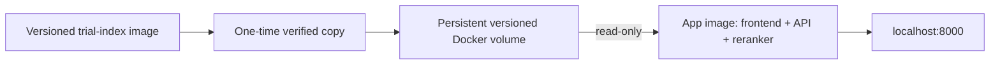

# App image plus a separate trial-index image

**Status:** files prepared; Compose configuration, source-index checksum and
seven Python tests passed. Docker engine access is denied in this session, so
neither image build nor the combined container startup has been verified.

The existing `compose.yaml` remains the local bind-mount option. The standalone
`compose.images.yaml` is an alternative; use one file at a time, not both stacks
on port8000. This setup requires Linux containers on x86-64 Docker Desktop.

## Build and start on the machine that holds the index

Ensure Docker Desktop is running. From the repository root:

```powershell
cd demo
docker compose -f compose.images.yaml config --quiet
docker compose -f compose.images.yaml build
docker compose -f compose.images.yaml up -d
docker compose -f compose.images.yaml ps -a
Invoke-RestMethod http://127.0.0.1:8000/health/ready
```

Build needs internet for the base image, Python dependencies and model download.
The data build reads `../data/indexes/bm25.sqlite` and rejects any bytes that do
not match `index-image/manifest.json`. The existing database is not modified.
Open **http://127.0.0.1:8000** once health reports ready. `trial-index` exiting
with code0 is expected: it initializes the data and completes; it is not a
database server that needs to remain running.

Do not run `build` or `up` if a preceding command failed. To inspect a failure:

```powershell
docker compose -f compose.images.yaml logs --tail 50
```

## What runs together



- App tag: `clinical-trial-matcher:local`.
- Data tag: `clinical-trial-index:trec2021-b70ca9cdb12e`.
- Persistent volume: `clinical-trial-index-trec2021-b70ca9cdb12e`.
- Dataset:375,580 trials,2,220,654,592 bytes. Full SHA-256 is pinned in the manifest
  and Compose definition. The image build verifies it; the initializer verifies
  the volume before allowing the app to start.
- First run copies the index into the empty volume. Later runs reuse a valid
  index without copying it. A checksum/size mismatch fails rather than replacing
  existing data. The non-root app mounts the volume read-only.
- An app-only update does not need another data download. Only pull/load/build
  the app image when its version changes; keep the data tag and volume unchanged.
  Re-downloading is necessary if the data image was removed and is needed again,
  or when deliberately selecting a different dataset version.
- Allow several GB of free Docker disk space beyond the existing database:
  the data image and initialized volume each contain the2.22GB index, in addition
  to app/model layers and build cache. Keeping the index separate saves repeated
  transfers on app updates, not total local storage.

## Share both images without a registry

After a successful local build and startup test, and after checking the dataset
terms for the intended recipients, export the two images:

```powershell
docker image save --output matcher-app.tar clinical-trial-matcher:local
docker image save --output matcher-index-trec2021.tar clinical-trial-index:trec2021-b70ca9cdb12e
```

Give the recipient both archives and `compose.images.yaml`. They do not need
Python, the source index folder, or Azure. In the folder containing those files:

```powershell
docker image load --input matcher-app.tar
docker image load --input matcher-index-trec2021.tar
docker compose -f compose.images.yaml up -d --no-build --pull never
```

`--no-build --pull never` uses the already loaded images, so source/build paths
are not needed on the recipient's computer. A compatible Docker installation is
still required. Images have not been published or exported by this session.

For a later app-only update, deliver/load only the new app archive, then run:

```powershell
docker compose -f compose.images.yaml up -d --no-build --pull never --no-deps --force-recreate matcher
```

This command is for an already initialized installation; initial startup must
include the data service. If sharing through a registry later, replace the local
app tag with a release tag and the data tag with a registry-qualified fixed tag.

## Stop and preserve data

```powershell
docker compose -f compose.images.yaml down
```

Ordinary `down` preserves the named volume. **Do not add `--volumes`/`-v` if you
want to retain the index.** A deliberate dataset upgrade should use a new data
tag, full checksum and volume name together; do not overwrite an active volume.

Screenshots and a demo video can be captured in the local browser. No Azure
subscription or paid inference service is required. Eligibility remains unchecked.

References: [Compose startup dependencies](https://docs.docker.com/compose/how-tos/startup-order/),
[Docker volumes](https://docs.docker.com/engine/storage/volumes/).
