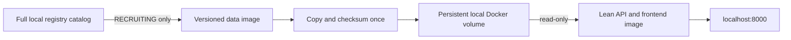

# App image and versioned recruiting-index image

The two-image Compose definition in `compose.images.yaml` pins a completed recruiting-only index by SHA-256 and uses a versioned named volume. `compose.yaml` is an alternative bind mount of the same local index. Run only one stack on port 8000.



## Build and run sequentially

From the project root, after `src/current_data.py --stage fetch`, `--stage build` and `scripts/prepare_current_demo.py` have completed:

```powershell
docker compose -f .\demo\compose.images.yaml config --quiet
docker compose -f .\demo\compose.images.yaml build trial-index
docker compose -f .\demo\compose.images.yaml build matcher
docker compose -f .\demo\compose.images.yaml up -d --no-build --pull never
docker compose -f .\demo\compose.images.yaml ps -a
Invoke-RestMethod http://localhost:8000/health/ready
```

Open http://localhost:8000. The initializer exits successfully; that is expected. It checks bytes, checksum and record-count metadata. A different existing index is rejected rather than overwritten. First startup copies the index; later complete starts verify and reuse it. An app-only update can skip the initializer:

```powershell
docker compose -f .\demo\compose.images.yaml build matcher
docker compose -f .\demo\compose.images.yaml up -d --no-build --pull never --no-deps --force-recreate matcher
```

The first Windows-to-Docker data-context transfer took several minutes on this low-memory host; app-only updates skip that transfer.

The app contains no downloaded model and needs no inference service. The full local registry catalog and raw pages are excluded from both images. Images are Linux/x86-64; other platforms are unverified. The serving manifest `data/manifests/ctgov-current.json` records exact index bytes, source release, counts and checksum. Historical TREC data/image/volume are separate and are not deleted by migration.

## Let another person run it

Publish public images (see [Azure instructions](AZURE.md)) or export the built images and send the Compose file. From the repository root:

```powershell
$m = Get-Content .\data\manifests\ctgov-current.json -Raw | ConvertFrom-Json
$tag = "$($m.dataset_id)-$($m.sha256.Substring(0,12))"
docker image save -o clinical-trial-demo.tar clinical-trial-matcher:local "clinical-trial-index:$tag"
```

The recipient loads the archive, places the supplied `compose.images.yaml` in a directory and runs:

```powershell
docker image load -i .\clinical-trial-demo.tar
docker compose -f .\compose.images.yaml up -d --no-build --pull never
```

No repository, raw database or Python installation is needed for this no-build path. Keep `--no-build` because the distributed Compose file also contains developer build paths. The index copy uses additional local disk space; the data image and initialized volume both contain its bytes. App updates reuse existing data layers when those layers are available locally. A new machine or Azure replica still needs to pull the data image.

Stop with `docker compose -f .\compose.images.yaml down`. Retain the volume by omitting `-v`. For a new data release use a new data tag and volume; never overwrite a historical release or claim its evaluation metrics apply to the refreshed corpus.

Run `python .\demo\verify_current.py` locally for sequential startup/search/restart/replacement/reuse checks. The previous `verify_docker.py` and `verify_app_update.py` are historical TREC/model checks; current lean-image checks live in `verify_current.py`.
