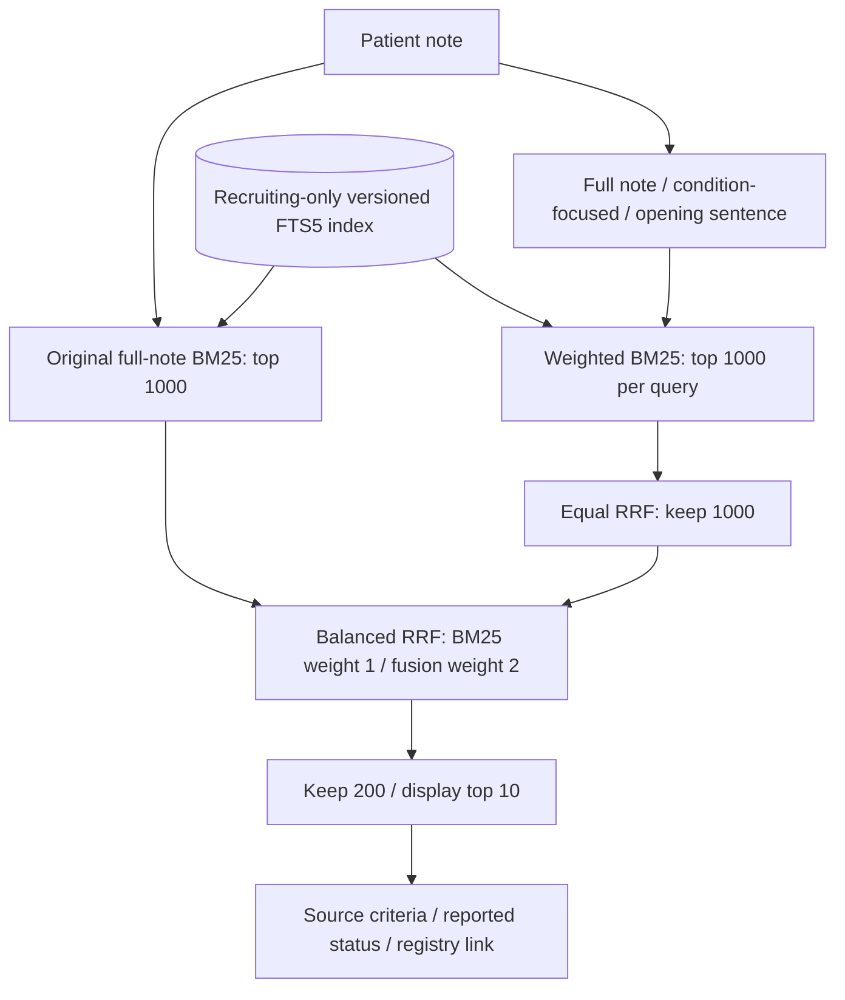

# Clinical Trial Matcher demo

One search button runs balanced fusion over a versioned **recruiting-only ClinicalTrials.gov index**. The frontend includes four synthetic notes: diabetes, breast cancer, asthma, and knee osteoarthritis. It displays ten candidates, original eligibility text, reported recruiting status, last registry update, and snapshot date. Eligibility is **not assessed**.

The historical 375,580-trial TREC corpus remains at `data/indexes/bm25.sqlite`. Completed TREC metrics describe that historical corpus; they do not measure relevance on the new recruiting collection. TREC 2022 has already been evaluated and is now a regression set, not an untouched holdout.

## Run with Docker

From the repository root, with Docker Desktop using Linux/x86-64 containers:

```powershell
docker compose -f .\demo\compose.images.yaml build trial-index
docker compose -f .\demo\compose.images.yaml build matcher
docker compose -f .\demo\compose.images.yaml up -d --no-build --pull never
Invoke-RestMethod http://localhost:8000/health/ready
```

Open http://localhost:8000. Build sequentially. The index service exits with code 0 after seeding/verifying its volume; the app stays running. Later launches only need the `up` command. Stop with `docker compose -f .\demo\compose.images.yaml down`; omit `-v` to retain the index.

For an app-only update:

```powershell
docker compose -f .\demo\compose.images.yaml build matcher
docker compose -f .\demo\compose.images.yaml up -d --no-build --pull never --no-deps --force-recreate matcher
```

The data image and versioned volume are reused. See [index distribution](INDEX-IMAGE.md), [current data](../reports/current-data/README.md), and [Azure preparation](AZURE.md). Images/data are not included in Git; a fresh clone needs published images or a local data build.

## Refresh data locally

Python 3.12 standard library is sufficient. These steps run sequentially with one low-priority process; raw pages and SQLite builds checkpoint for resumption.

```powershell
.\.venv\Scripts\python.exe -S .\src\current_data.py --stage fetch
.\.venv\Scripts\python.exe -S .\src\current_data.py --stage build
.\.venv\Scripts\python.exe -S .\scripts\prepare_current_demo.py
```

The fetch downloads every registry record for the selected fields (identity, title, conditions, brief/detailed descriptions, eligibility, ages, sex, status, dates, countries). It is **not** a complete all-field copy of ClinicalTrials.gov. Compressed source pages and the full local catalog stay ignored by Git. Only `RECRUITING` records enter the serving index; `NOT_YET_RECRUITING`, invitation-only and closed records do not. The build checks page checksums, duplicate IDs, counts, SQLite integrity, and release provenance before publishing a serving manifest. A source version change during pagination fails the download rather than publishing a mixed release.

Each release has a new directory, checksum, image tag and Docker volume. The historical benchmark is untouched. Re-run fetch/build to resume an interrupted release. A later API release creates a new directory and starts a fresh release.

## Pipeline



RRF uses constant 60. Weighted searches use title 3, conditions 5, summary 1, eligibility 0.5. The current index generates its own condition vocabulary from its registry records. No neural reranking or paid API is used by the default app. No criterion-level eligibility explanation is generated.

Explicit research API methods `bm25`, `fusion`, and `rerank` remain supported. The lean image has no model runtime, so `rerank` returns 422. To reproduce optional historical MiniLM experiments outside this image, install `requirements-demo.txt`, download the pinned model with `download_model.py`, and set `RERANK_MODEL_DIR`. The default frontend still offers one pipeline.

## Local Python alternative

```powershell
py -3.12 -m venv .venv-demo
.\.venv-demo\Scripts\python.exe -m pip install -r .\demo\requirements-retrieval.txt
$m = Get-Content .\data\manifests\ctgov-current.json -Raw | ConvertFrom-Json
$env:TRIAL_INDEX_PATH = (Resolve-Path $m.index).Path
Set-Location demo
..\.venv-demo\Scripts\python.exe serve.py
```

Stop with Ctrl+C. The API opens SQLite read-only. `GET /config` describes the loaded collection; `GET /health/ready` and `/health/live` serve probes. `POST /match` accepts `note` (20–12,000 characters) and optional `top_k` (1–10).

## Resource and privacy controls

Docker limits the app to 0.5 CPU / 1 GiB; one worker allows one active search and up to 10 search attempts/minute globally. Excess requests return 429. This in-process limit resets on restart and is not a billing cap or a complete abuse defense. The container uses an unprivileged user, a read-only filesystem/index mount, and no model runtime.

For a private PoC, set both `DEMO_USERNAME` and `DEMO_PASSWORD`, plus `REQUIRE_AUTH=true`. Use HTTPS remotely. Access logging is disabled and the app does not persist notes; responses use `no-store`. Use synthetic notes, since browser state, exports, proxies or hosting infrastructure can retain information.

## Verification

Run tests sequentially using a working Python environment with the test dependencies:

```powershell
$env:PYTHONPATH = "$PWD;$PWD\demo"
python -m pytest .\tests\test_current_data.py .\demo\tests -q
python .\demo\verify_current.py
```

The Docker check launches the current two-image stack, searches all four examples, checks reported recruiting status and absence of model packages, then tests restart, app container replacement, and verified index reuse. These are operational smoke tests, not clinical validation or current-corpus relevance evaluation. Results are in `reports/current-data/`. Historical Docker results remain in `VERIFICATION.md`; Azure deployment remains a separate verification step.
